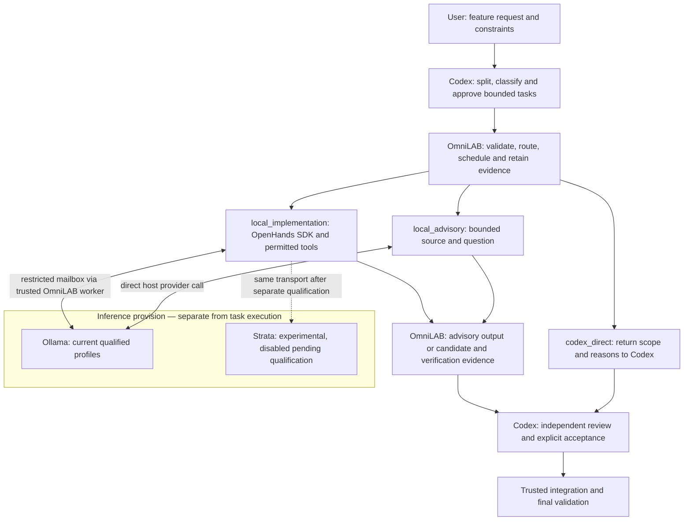
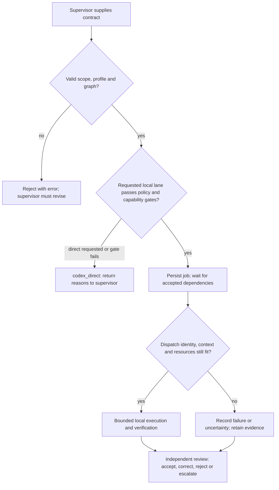

# OmniLAB / LocalAgentBridge

**[Documentation website](https://nishdel.github.io/OmniLAB-Local-Agent-Bridge-/)** ·
[Documentation index](docs/index.md) · [Standalone access](docs/OPERATIONS.md)

LAB helps a developer use a local model for a small part of a coding task while
keeping supervision, evidence and acceptance explicit. It is useful when you
already use Codex and Ollama and want reviewable local explanations, code reviews,
tests or bounded fixes, with durable jobs that survive closing the user interface.
It does not yet establish that delegation saves time, cloud allowance or money.

Start with a **small advisory task**: choose a repository and installed model,
submit a focused question with selected source, inspect the saved answer, and
record your independent review. The [quickstart](docs/QUICKSTART.md) provides the
commands; the [user guide](docs/USER-GUIDE.md) explains the dock and status labels.

## What is available?

| Scope | What the evidence supports |
|---|---|
| Released v0.4.1 | Local analysis/MCP tools, model routing and usage/dashboard functionality. See [release verification](VERIFICATION-v0.4.1.md). |
| Development candidate: **0.5.0.dev0** | Durable companion jobs, retained adaptive/workflow interfaces, and opt-in selective advisory/implementation contracts. This branch is a draft candidate, not a completed release. [Release gates](docs/RELEASE-READINESS.md) still apply. |
| Owner's qualified personal deployment | Specific Ollama/Qwen27 advisory and restricted OpenHands cases; Qwen35 has separately accepted fixture/UTC cases. These are narrow, dated results, not universal defaults or permission to delegate arbitrary work. [Exact profiles and evidence](docs/WORKFLOW.md#qualified-personal-profile). |
| Experimental Strata | Adapter and exact context accounting implemented; isolated patched A/B probes passed historically. Disabled here: memory/exclusivity, OpenHands execution and live safety qualification remain unresolved. [Current qualification](docs/SELECTIVE-IMPLEMENTATION-REPORT.md#exact-context-accounting--2026-10-13). |
| Still untested | Full human dock acceptance, broader task-category quality and complete matched cloud/time/energy savings. [The existing eleven-row ledger](docs/release-testing/selective-execution-issue-draft.md) records two incomplete observations and nine untested rows. |

Windows is the tested desktop target. Other systems are not certified. Personal
machine paths, installed model choices and the owner's frozen runtime are not
installation requirements for other users.

## How it works

- **Codex** interprets your request, creates bounded subtasks, supplies risk and
  scope labels, and reviews the result. This supervision may use cloud services.
- **LAB** is the Python bridge, durable queue and policy/evidence layer. It checks
  supplied contracts; it does not autonomously decompose arbitrary requests.
- **OpenHands** manages the permitted read/edit/test loop for selective
  implementation in a restricted networkless sandbox. Advisory jobs do not use
  it. This integration uses the SDK, not an OpenHands web UI.
- **Ollama or Strata** serves the selected model locally. They are alternative
  providers, not successive stages. Strata remains experimental and disabled.
- **The model** generates an answer or proposes tool calls. Its confidence or
  claim of success cannot grant permissions, accept a patch or publish anything.

The [workflow guide](docs/WORKFLOW.md#python-decisions-in-the-selective-path)
explains the actual Python decisions, defaults and tests. Its
[execution sequence](docs/WORKFLOW.md#bounded-implementation-sequence) shows the
mailbox, tools, protected verification and independent review.

Task lanes answer **who does the work**; inference providers answer **who serves
the model**. Ollama can serve both local lanes: advisory asks for text, while
OpenHands implementation asks for responses in a bounded tool loop. Strata's next
target is inference for that same OpenHands loop, not a replacement for OpenHands.
Its adapter can also carry advisory text, but this does not qualify either lane.
Failure of Strata qualification does not remove the Ollama advisory path.
See the [qualification roadmap](docs/INFERENCE-ROADMAP.md) and separate
[Janas research scope](docs/research/JANAS.md).

`codex_direct` returns control and reasons. It is **not an automatic cloud call or
silent fallback**. Contract jobs are bounded single stages. The retained
[adaptive workflow](docs/ADAPTIVE-DELEGATION.md) has its own deterministic
selection rules; those rules do not govern every interface.

## Your first useful task

You need a compatible Python environment, a LAB configuration pointing to the
intended source and separate data store, and an already installed completion
model available through Ollama. The Windows dock additionally needs Tcl/Tk;
managed Codex callbacks need authenticated Codex CLI. Local trusted review is
also supported. An advisory task needs no OpenHands sandbox.

Use the [quickstart](docs/QUICKSTART.md) to check the selected configuration and
inventory, create a run and submit the example task. You submit an objective,
bounded context and exact model choice. You receive a durable job ID, then an
answer, available usage, errors and a review event. Read the evidence and check
the answer against the source before recording acceptance and finalizing the run.
**Finished generation is not accepted work.**

Implementation additionally needs a separately qualified provider/profile and
restricted executor, explicit file/tool permissions, protected acceptance checks
and enough host resources. Follow the [selective setup](docs/SELECTIVE-SETUP.md)
only when that lane is needed. LAB does not install or delete models for you.

The model selector affects future eligible jobs; explicit job choices take
precedence. Use the same configuration/store when reopening the dock. Closing it
hides the view and leaves jobs running; pausing prevents new claims. Cancellation
of an HTTP request does not prove a shared server stopped generation. See
[safe stopping and reopening](docs/USER-GUIDE.md#choose-the-model-and-store).

## What stays local, and what may leave?

Task snapshots, local model inference, SQLite job/usage records and candidate
artifacts stay on the configured machine. The selective implementation sandbox
has no external network or host-home mount; trusted LAB mediates inference.
Supplying file paths limits which source LAB reads, but does not itself guarantee
that source never reaches cloud supervision.

Your Codex prompts, selected excerpts, returned findings, diffs and verification
evidence may be sent to its configured cloud service during planning or review.
Managed callbacks also send their bounded report. Review that content and your
provider's settings for sensitive work. See [security](SECURITY.md) and the
[trust boundaries](docs/WORKFLOW.md#source-map).

## Deliberate limits

LAB does not grant itself new permissions, approve its own results, silently
switch models, resize qualified contexts, or turn local token counts into claimed
cloud savings. It does not automatically merge, release, deploy, change a
subscription, install an engine or manage unrelated applications. Explicit
trusted integration exists only after independent acceptance and checks.

The [matched comparison protocol](docs/SELECTIVE-PILOT.md#readiness-comparison)
now prepares six synthetic task categories, four exact configurations, complete
usage accounting and timestamped energy reporting. Its mock results validate
instrumentation, not model quality. Live trials need the bounded approval package
there; no broader routing recommendation or subscription downgrade is established.

## Documentation map

| Need | Guide |
|---|---|
| Python walkthrough, instructional example and source/test map | [Workflow](docs/WORKFLOW.md) |
| First advisory and dock controls | [Quickstart](docs/QUICKSTART.md), [user guide](docs/USER-GUIDE.md) |
| Exact configuration, qualification and operations | [Configuration](docs/CONFIGURATION.md), [selective setup](docs/SELECTIVE-SETUP.md) |
| Recovery and privacy | [Recovery](docs/RECOVERY.md), [troubleshooting](docs/TROUBLESHOOTING.md), [security](SECURITY.md) |
| Delegation/subscription decisions, accounting and live approval | [Matched pilot](docs/SELECTIVE-PILOT.md) |
| Historical benchmarks and implementation evidence | [Benchmarks](docs/benchmarks/README.md), [implementation report](docs/SELECTIVE-IMPLEMENTATION-REPORT.md), [qualification](docs/OPENHANDS-STRONGER-QUALIFICATION.md) |
| Human acceptance and release scope | [Manual testing](docs/MANUAL-RELEASE-TESTING.md), [eleven-row ledger](docs/release-testing/selective-execution-issue-draft.md), [readiness](docs/RELEASE-READINESS.md) |
| Retained interfaces and contribution history | [Architecture](docs/ARCHITECTURE.md), [workflows](docs/WORKFLOWS.md), [durable workflows](docs/COMPANION-WORKFLOWS.md), [profiles](docs/PROFILES.md), [feature matrix](docs/FEATURE-PRESERVATION.md), [contributions](docs/LOCAL-CONTRIBUTIONS.md) |
| Development and project policy | [Contributing](CONTRIBUTING.md), [AGENTS](AGENTS.md), [delegation policy](CODEX_POLICY.md), [migration](MIGRATION-v0.5.md), [snapshot](docs/DEVELOPMENT-SNAPSHOT.md), [decisions](docs/DECISIONS.md), [dependencies](docs/DEPENDENCIES.md), [changelog](CHANGELOG.md) |
