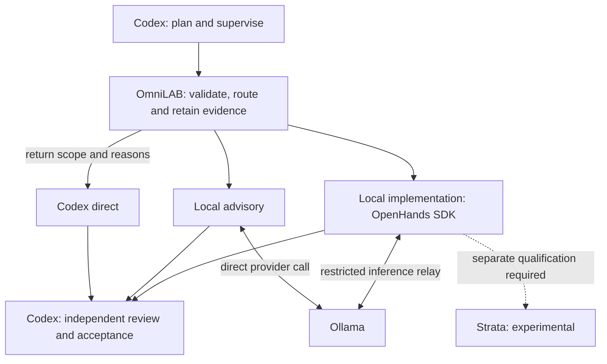

# OmniLAB / LocalAgentBridge

**Local AI assistance for coding, with explicit supervision and review.**

OmniLAB connects Codex to local models for focused explanations, code reviews,
tests and bounded fixes. It keeps exact model choices, durable jobs and saved
evidence together, so a supervisor can inspect and accept each contribution.

**[Get started](docs/QUICKSTART.md)** · **[Browse the guides](docs/index.md)** ·
**[Open an application](docs/OPERATIONS.md)** ·
**[Documentation website](https://nishdel.github.io/OmniLAB-Local-Agent-Bridge-/)**

> **Development source: 0.5.0.dev0. Latest released version: v0.4.1.**
> Merging source does not qualify experimental engines, upgrade an installed
> runtime or publish a release. See [current status](#current-status).

## Start here

| I want to… | Start with |
|---|---|
| Try a small task with my local model | [Quickstart](docs/QUICKSTART.md) — submit an advisory, inspect the answer and record a review |
| Use the dock, change models or recover a job | [User guide](docs/USER-GUIDE.md) and [troubleshooting](docs/TROUBLESHOOTING.md) |
| Find Ollama, OpenHands or Strata | [Standalone access](docs/OPERATIONS.md) — application controls, browser availability and current blockers |
| Understand the code and task boundaries | [Workflow walkthrough](docs/WORKFLOW.md) — source links, examples and verification |
| Contribute a change | [Contributing](CONTRIBUTING.md) — isolated development, checks and review |

Start with a focused advisory question and selected source. Use an exact installed
model, inspect its saved answer against the source, then record your independent
decision. **Finished generation is not accepted work.**

Windows is the tested desktop target. The candidate needs Python 3.11+, a private
LAB configuration/data store, Ollama and an installed completion model. The dock
also needs Tcl/Tk; managed Codex reviews need an authenticated Codex CLI. Local
trusted review is supported. Follow the quickstart for installation and commands.

## How it works

Three task lanes share explicit scope, evidence and independent acceptance:

- **Codex direct** returns the scope and reasons to the supervisor. LAB does not
  make an automatic cloud call or silently change models.
- **Local advisory** asks a local model for bounded analysis. It works independently
  of OpenHands qualification.
- **Local implementation** gives OpenHands a restricted read/edit/test loop.
  The networkless sandbox reaches inference through a trusted LAB relay; the
  supervisor checks the candidate and protected acceptance results.

Ollama and Strata are alternative inference providers. Strata is disabled pending
qualification. LAB uses the **OpenHands SDK**, which does not install an OpenHands
browser application. The [workflow guide](docs/WORKFLOW.md#python-decisions-in-the-selective-path)
explains the routing decisions; its [execution sequence](docs/WORKFLOW.md#bounded-implementation-sequence)
shows transport, permitted tools and verification.

## Current status

| Area | Supported scope |
|---|---|
| **Released v0.4.1** | Local analysis/MCP tools, model routing, usage and dashboard functionality. [Release evidence](docs/releases/VERIFICATION-v0.4.1.md) |
| **Development 0.5.0.dev0** | Durable companion jobs, retained adaptive/workflow interfaces and opt-in selective task contracts. [Release gates remain open](docs/RELEASE-READINESS.md) |
| **Qualified personal profiles** | Dated Ollama/Qwen27 advisory and restricted OpenHands cases; separately accepted Qwen35 fixture/UTC cases. [Exact profiles and limits](docs/WORKFLOW.md#qualified-personal-profile) |
| **Strata standalone** | Coder artifacts are verified; browser, API, inference, resource and lifecycle acceptance remain blocked or untested. [Standalone qualification](docs/STRATA-STANDALONE.md) |
| **OpenHands + Strata** | Blocked on Strata standalone acceptance and separate bounded edit/test qualification. [Integration guide](docs/OPENHANDS-STRATA.md) |
| **Broader acceptance** | Human dock checks and matched cloud/time/energy savings remain incomplete. [Human ledger](docs/release-testing/selective-execution-issue-draft.md), [comparison protocol](docs/SELECTIVE-PILOT.md#readiness-comparison) |

These personal profiles are dated, narrow observations; they are not public
hardware requirements or permission for arbitrary tasks. Other operating systems
are not certified. Independent Janas experiments have their own
[research and access guide](docs/research/JANAS.md).

## Documentation

The guides render directly on GitHub. The [documentation website](https://nishdel.github.io/OmniLAB-Local-Agent-Bridge-/)
presents the same source with search and sidebar navigation.

| Topic | Guides |
|---|---|
| Setup and everyday use | [Quickstart](docs/QUICKSTART.md) · [User guide](docs/USER-GUIDE.md) · [Configuration](docs/CONFIGURATION.md) |
| Architecture and source | [Workflow](docs/WORKFLOW.md) · [Retained interfaces](docs/ARCHITECTURE.md) · [Feature preservation](docs/FEATURE-PRESERVATION.md) |
| Independent applications | [Access and Docker](docs/OPERATIONS.md) · [Strata standalone](docs/STRATA-STANDALONE.md) · [Provider roadmap](docs/INFERENCE-ROADMAP.md) |
| Safety and recovery | [Security](SECURITY.md) · [Recovery](docs/RECOVERY.md) · [Troubleshooting](docs/TROUBLESHOOTING.md) |
| Testing and qualification | [Implementation evidence](docs/SELECTIVE-IMPLEMENTATION-REPORT.md) · [Manual testing](docs/MANUAL-RELEASE-TESTING.md) · [Release readiness](docs/RELEASE-READINESS.md) |
| Release history and project policy | [Upgrades and release evidence](docs/releases/README.md) · [Changelog](CHANGELOG.md) · [Contributing](CONTRIBUTING.md) · [Delegation policy](CODEX_POLICY.md) |

See the [documentation index](docs/index.md) for the retained workflow
interfaces, benchmarks, decisions and contribution history.

## Privacy and evidence

Task snapshots, local inference, SQLite records and candidate artifacts stay on
the configured machine. Selected source, findings, diffs and verification evidence
may reach Codex's configured cloud service during planning or review. Check that
content and your provider settings for sensitive work. The selective sandbox has
no external network or host-home mount; trusted LAB mediates inference.

Models propose work. They cannot grant permissions, approve their own results,
merge, publish or install another engine. Local token counts do not establish
cloud savings; that claim requires an equivalent accepted baseline with complete
overhead and usage accounting. The [comparison protocol](docs/SELECTIVE-PILOT.md)
separates synthetic instrumentation checks from live evidence.

## Repository map

| Location | Contents |
|---|---|
| [localagentbridge/](localagentbridge/) | Python package, CLI, durable stores and restricted executor |
| [docs/](docs/index.md) | User guides, architecture, qualification and [release history](docs/releases/README.md) |
| [examples/](examples/) and [profiles/](profiles/) | Example task contracts and configurations |
| [tests/](tests/) and [scripts/](scripts/) | Regression coverage, documentation checks and release audits |
| [website/](website/) | Documentation website built from the same Markdown |

Contributors should read [CONTRIBUTING.md](CONTRIBUTING.md) and
[AGENTS.md](AGENTS.md). OmniLAB is [MIT licensed](LICENSE); model and dependency
licenses are separate.
