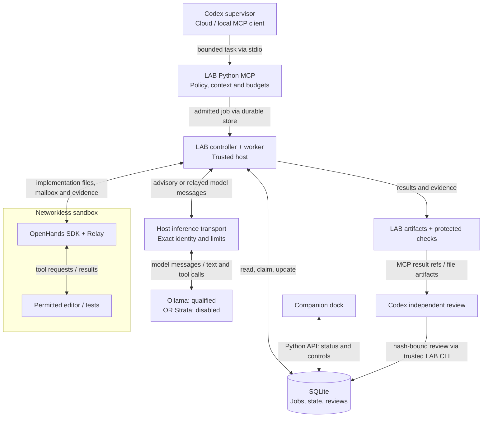
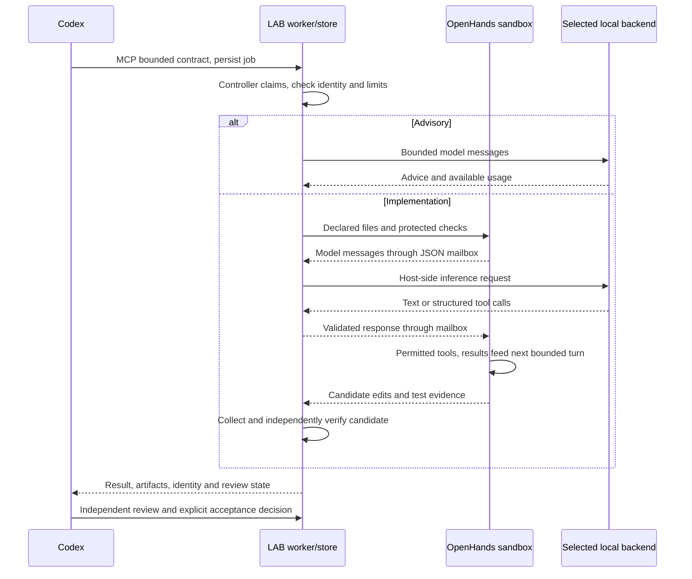

# OmniLAB / LocalAgentBridge

LAB turns selected local work into durable, bounded jobs. Codex plans and reviews;
OpenHands manages permitted implementation tools; Ollama runs the selected local
model. A Windows companion dock exposes job and review state.

**0.5.0.dev0 is a development snapshot, not a completed release.** The public
v0.4.1 functionality and existing v0.5 workflows remain supported. Start with the
[complete workflow guide](docs/WORKFLOW.md), then the [quickstart](docs/QUICKSTART.md)
or [qualified project operations](docs/SELECTIVE-SETUP.md#qwen27-project-workflow).

<a id="system-overview"></a>
## How it works

You give Codex a task. Codex breaks off a small, clearly bounded piece and asks
LAB to handle it on your computer. LAB checks the chosen model, allowed files,
resource limits and instructions through the `companion_contract_submit` MCP
entry point, then saves a job. Advice goes directly to the
model. Implementation uses OpenHands to ask for permitted edits and tests in an
isolated container. LAB brings the result and evidence back; Codex checks them
before accepting any work. Codex supervision can use cloud services even when
model inference and task files stay local.



**Backend status:** Ollama has scoped live-verified paths. Strata is implemented
but disabled and unqualified; it cannot be selected for execution here. Only one
inference backend is used for a job. The container is nonroot, has no host mounts, and exchanges JSON mailbox files
through fixed trusted Docker transport. The host worker constructs and
validates model requests; SQLite only persists records. Advisory jobs do not use
OpenHands. The dock reads and changes the companion store through Python; a
separate optional [usage collector and dashboard](docs/WORKFLOW.md#accounting-and-observability)
read local/cloud usage metadata into `usage.sqlite3`. They do not dispatch jobs.
The [source map](docs/WORKFLOW.md#source-map) identifies each component and its tests.



The sequence describes the implemented route, **not complete Strata qualification**.
Ollama/Qwen27 and Qwen35 have specific accepted OpenHands cases. The **Strata 0.1.43
engine with LAB-specific serving patch**, final revision plus engine-only
`STRATA_FILE_RELEASE=1`, now passed a fresh bounded probe and durable LAB advisory.
Native mapped-page release was verified active, but idle RAM stayed below the
6 GiB admission requirement. A competing inference process later triggered the
whole-GPU guard during observation. OpenHands/Strata and deliberate live
failure/cancellation checks remain unqualified; general Strata routing is disabled.
The [model-free readiness audit](docs/SELECTIVE-IMPLEMENTATION-REPORT.md#next-session-readiness-decision--2026-10-13)
withholds another startup: the complete memory envelope and SDK context admission
remain unresolved; store-local reservations do not provide machine-wide exclusivity.
Test settings were restored and active LAB/Ollama preserved. See the
[current qualification](docs/SELECTIVE-IMPLEMENTATION-REPORT.md#windows-mapped-page-release-trial--2026-10-13)
and [workflow, lifecycle and trust views](docs/WORKFLOW.md).

## Current project deployment

The dated personal profile uses exact `qwen3.8:27b` through Ollama, with supervised
local-first documentation and small-fix routing **only in the selective execution
project worktree**. Public model selection and explicit per-job overrides remain.
The [identity and effective profile](docs/WORKFLOW.md#qualified-personal-profile)
are an example qualification, not a mandatory model for other users.

OpenHands SDK/tools 1.53.0 is exercised through the restricted, networkless
container/mailbox path. **No OpenHands web UI is installed.** The optional Strata
adapter and pinned runtime are installed in the isolated test environment,
with exact loaded GGUF/PLE identity and bounded A/B inference verified in the
isolated trial. It is currently stopped and disabled; insufficient memory
headroom and remaining execution/safety qualification block general use. Full human acceptance remains
outstanding in the
[manual ledger](docs/release-testing/selective-execution-issue-draft.md).
Operating token savings are **not established**.

## Start here

Use Windows, Python 3.11+ with Tcl/Tk, Git, an Ollama server with an installed
completion model, and authenticated Codex CLI when using managed reviews.
The package never installs or deletes models.

```powershell
py -3 -m venv .venv
.\.venv\Scripts\python.exe -m pip install ".[tray]" -c requirements.lock.txt
.\.venv\Scripts\python.exe -m localagentbridge --config examples/companion.toml companion inventory
```

These are generic installation instructions, not commands to replace the active
qualified controller. Use a non-editable installation for a coordinating runtime.
Follow the quickstart to choose a worktree/model and submit a bounded task.

## Documentation map

| Need | Guide |
|---|---|
| Complete workflow, source map, sequence/lifecycle/trust/accounting diagrams | [Workflow](docs/WORKFLOW.md) |
| Setup, verified start/stop/status, SDK access, disabled Strata and rollback | [Selective setup and operations](docs/SELECTIVE-SETUP.md) |
| Dock, model selector and review controls | [User guide](docs/USER-GUIDE.md) |
| Configuration and CLI flags | [Generated reference](docs/CONFIGURATION.md) |
| Safety, privacy and recovery | [Security](SECURITY.md), [recovery](docs/RECOVERY.md), [troubleshooting](docs/TROUBLESHOOTING.md) |
| Usage attribution and honest savings methodology | [Accounting](docs/SELECTIVE-PILOT.md) |
| Live qualification and immutable package evidence | [Qualification](docs/OPENHANDS-STRONGER-QUALIFICATION.md), [development snapshot](docs/DEVELOPMENT-SNAPSHOT.md) |
| Human checks and unresolved local issue entries | [Manual testing](docs/MANUAL-RELEASE-TESTING.md), [selective checklist](docs/release-testing/selective-execution-issue-draft.md) |
| Retained interfaces, skills, profiles and workflows | [Architecture](docs/ARCHITECTURE.md), [workflows](docs/WORKFLOWS.md), [durable workflows](docs/COMPANION-WORKFLOWS.md), [profiles](docs/PROFILES.md), [adaptive routing](docs/ADAPTIVE-DELEGATION.md) |
| Preservation and contribution history | [Feature matrix](docs/FEATURE-PRESERVATION.md), [local contributions](docs/LOCAL-CONTRIBUTIONS.md), [role mapping](docs/ROLE-MIGRATION.md) |
| Development, upgrade and release gates | [Contributing](CONTRIBUTING.md), [AGENTS](AGENTS.md), [migration](MIGRATION-v0.5.md), [readiness](docs/RELEASE-READINESS.md) |

## Authority and limits

A finished inference is not accepted work. Codex independently inspects evidence,
records review decisions and validates before finalization. Legacy/advisory
models propose text without tools. In the selective implementation lane,
OpenHands can execute only contract-permitted tools inside the approved sandbox.
Explicit trusted patch integration exists; models cannot accept or integrate
their own work.

Closing the dock hides it without stopping jobs. HTTP cancellation alone cannot
prove a shared inference server stopped generation; uncertain ownership retains
the reservation. No automatic startup service or bundled EXE is supplied.
Windows is the tested desktop target; other systems are not certified.

The [usage dashboard](docs/DASHBOARD.md) and dock show available measurements,
not demonstrated cloud savings. Local tokens, configured context and maximum
output are different quantities. See also [decisions](docs/DECISIONS.md),
[dependency notices](docs/DEPENDENCIES.md), [changelog](CHANGELOG.md),
[delegation policy](CODEX_POLICY.md) and [historical benchmarks](docs/benchmarks/README.md).
