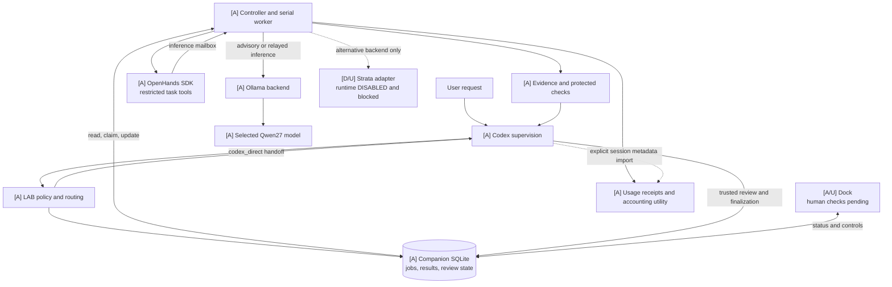

# OmniLAB / LocalAgentBridge

LAB turns selected local work into durable, bounded jobs. Codex plans and reviews;
OpenHands manages permitted implementation tools; Ollama runs the selected local
model. A Windows companion dock exposes job and review state.

**0.5.0.dev0 is a development snapshot, not a completed release.** The public
v0.4.1 functionality and existing v0.5 workflows remain supported. Start with the
[complete workflow guide](docs/WORKFLOW.md), then the [quickstart](docs/QUICKSTART.md)
or [qualified project operations](docs/SELECTIVE-SETUP.md#qwen27-project-workflow).

## System overview



**Legend:** `[A]` active and exercised; `[D]` implemented/configured but disabled;
`[O]` optional or conditional; `[U]` untested or blocked. Dashed connections are
conditional alternatives or explicit collection, not permission grants. SQLite
stores records; the controller/worker reads and changes them. It does not dispatch
work independently. See the guide for the exact [transport boundary](docs/WORKFLOW.md#trust-boundaries-and-data-movement)
and [accounting limitations](docs/WORKFLOW.md#accounting-and-observability).

## Current project deployment

The dated personal profile uses exact `qwen3.8:27b` through Ollama, with supervised
local-first documentation and small-fix routing **only in the selective execution
project worktree**. Public model selection and explicit per-job overrides remain.
The [identity and effective profile](docs/WORKFLOW.md#qualified-personal-profile)
are an example qualification, not a mandatory model for other users.

OpenHands SDK/tools 1.53.0 is exercised through the restricted, networkless
container/mailbox path. **No OpenHands web UI is installed.** The optional Strata
adapter exists, but its runtime remains disabled and unqualified. No Strata
service address is verified. Eleven human checks remain unperformed in the
[manual ledger](docs/release-testing/selective-execution-issue-draft.md).
Operating token savings are **not established**.

## Start here

Use Windows, Python 3.11+ with Tcl/Tk, Git, an Ollama server with an installed
completion model, and authenticated Codex CLI when using managed reviews.
The package never installs or deletes models.

```powershell
py -3 -m venv .venv
.\.venv\Scripts\python.exe -m pip install ".[tray]" -c requirements.lock.txt
.\.venv\Scripts\python.exe -m localagentbridge --config examples/companion.toml companion inventory
```

These are generic installation instructions, not commands to replace the active
qualified controller. Use a non-editable installation for a coordinating runtime.
Follow the quickstart to choose a worktree/model and submit a bounded task.

## Documentation map

| Need | Guide |
|---|---|
| Complete workflow, source map, sequence/lifecycle/trust/accounting diagrams | [Workflow](docs/WORKFLOW.md) |
| Setup, verified start/stop/status, SDK access, disabled Strata and rollback | [Selective setup and operations](docs/SELECTIVE-SETUP.md) |
| Dock, model selector and review controls | [User guide](docs/USER-GUIDE.md) |
| Configuration and CLI flags | [Generated reference](docs/CONFIGURATION.md) |
| Safety, privacy and recovery | [Security](SECURITY.md), [recovery](docs/RECOVERY.md), [troubleshooting](docs/TROUBLESHOOTING.md) |
| Usage attribution and honest savings methodology | [Accounting](docs/SELECTIVE-PILOT.md) |
| Live qualification and immutable package evidence | [Qualification](docs/OPENHANDS-STRONGER-QUALIFICATION.md), [development snapshot](docs/DEVELOPMENT-SNAPSHOT.md) |
| Human checks and unresolved local issue entries | [Manual testing](docs/MANUAL-RELEASE-TESTING.md), [selective checklist](docs/release-testing/selective-execution-issue-draft.md) |
| Retained interfaces, skills, profiles and workflows | [Architecture](docs/ARCHITECTURE.md), [workflows](docs/WORKFLOWS.md), [durable workflows](docs/COMPANION-WORKFLOWS.md), [profiles](docs/PROFILES.md), [adaptive routing](docs/ADAPTIVE-DELEGATION.md) |
| Preservation and contribution history | [Feature matrix](docs/FEATURE-PRESERVATION.md), [local contributions](docs/LOCAL-CONTRIBUTIONS.md), [role mapping](docs/ROLE-MIGRATION.md) |
| Development, upgrade and release gates | [Contributing](CONTRIBUTING.md), [AGENTS](AGENTS.md), [migration](MIGRATION-v0.5.md), [readiness](docs/RELEASE-READINESS.md) |

## Authority and limits

A finished inference is not accepted work. Codex independently inspects evidence,
records review decisions and validates before finalization. Legacy/advisory
models propose text without tools. In the selective implementation lane,
OpenHands can execute only contract-permitted tools inside the approved sandbox.
Explicit trusted patch integration exists; models cannot accept or integrate
their own work.

Closing the dock hides it without stopping jobs. HTTP cancellation alone cannot
prove a shared inference server stopped generation; uncertain ownership retains
the reservation. No automatic startup service or bundled EXE is supplied.
Windows is the tested desktop target; other systems are not certified.

The [usage dashboard](docs/DASHBOARD.md) and dock show available measurements,
not demonstrated cloud savings. Local tokens, configured context and maximum
output are different quantities. See also [decisions](docs/DECISIONS.md),
[dependency notices](docs/DEPENDENCIES.md), [changelog](CHANGELOG.md),
[delegation policy](CODEX_POLICY.md) and [historical benchmarks](docs/benchmarks/README.md).
