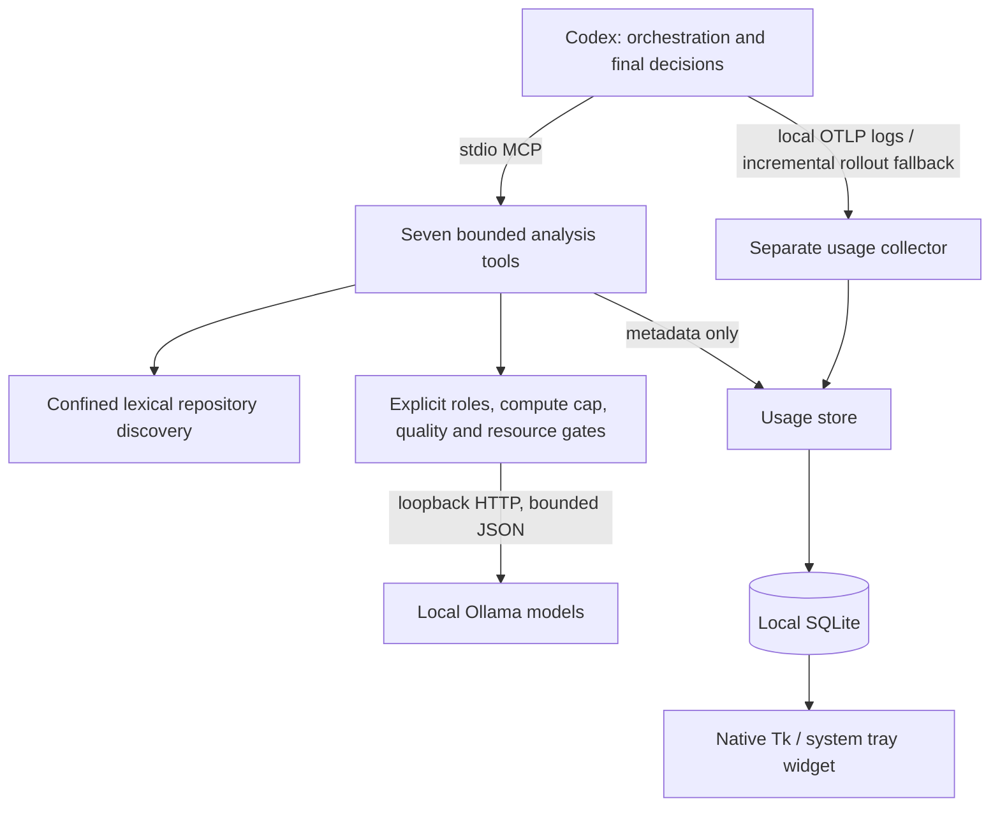
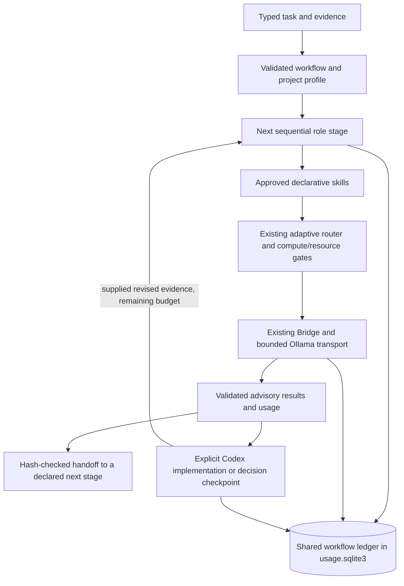

# Architecture

`server.py` declares MCP schemas; `service.py` prepares bounded content and evidence.
`context.py` performs lexical discovery without embeddings. `adaptive.py` chooses
the smallest eligible capability strength; `models.py` provides shared gates used
by the dashboard. A compute cap is a ceiling, never a command to run the largest
model. Missing models produce explicit installation advice, never substitutions.

At most two attempts by default, with a configurable maximum of three. Stronger
attempts receive the original bounded evidence, not the prior model's answer.
Complex work, risk/ambiguity triage, exhausted attempts, confidence/format failures,
capability, memory and reviewed-quality limits can return work to Codex. A handoff
is a recommendation, not an automatically executed cloud request.

`bridge.py` serializes calls within each server instance and streams Ollama output.
Different MCP instances are not globally serialized; avoid concurrent heavy runs
on constrained hardware. It never executes generated code or model tool calls.
Fixed consensus is two or three configured roles, with Codex resolving disagreement.

`telemetry.py` writes allowlisted metadata to SQLite, including logical task IDs,
intermediate attempts and final returned payload sizes. These are distinct accounting
units. `collector.py`, `otel.py` and `codex_usage.py` run independently of MCP.
`dashboard_state.py` derives readable model states; `dashboard.py` uses native tabs.
Hardware process sampling runs only during explicit benchmarks.

Older single-model configs and v0.1 tool arguments remain supported. SQLite
migrations only add tables/columns; a new checkout creates an empty local database.

## Opt-in v0.5 workflow layer

`catalog.py` validates data-only TOML skills, semantic roles, sequential workflows
and project profiles. These semantic roles are distinct from the legacy
general/coding/reasoning model bindings. Profiles can narrow requirements and
budgets, replace/remove local stages, and explicitly constrain model candidates.
They cannot remove Codex checkpoints or bypass the router's gates.

`workflow.py` advances one role or checkpoint per caller request. It supplies
bounded evidence to existing analysis adapters, adds an implementation-plan
schema, and prevents local output from performing actions. Every workflow ends
with a caller-recorded Codex decision. An implementation checkpoint accepts actual
diff/test evidence supplied after Codex performs the work. No model edits files,
runs tests, invokes tools, creates agents, or dispatches cloud work.

`workflow_store.py` adds a durable ledger to the existing metadata database.
Generations reserve shared attempts, corrections, context/output allowances and
active execution time. Stable task IDs, version checks, evidence/configuration
digests and a per-data-directory workflow lease prevent silent replay or overlap.
Raw task text, prompts, model results and checkpoint notes are not persisted by
the workflow ledger. Callers retain returned handoffs and re-supply them after a
restart. Routing metadata stays visible to Codex but is excluded from subsequent
model prompts. Revision invalidates prior result references without refunding
attempts or time.

The lease covers workflow execution sharing one data directory; legacy calls
remain serialized only within each Bridge instance. This is cooperative local
orchestration, not an OS resource governor or authentication boundary. Native
usage cards continue to show existing generation telemetry; workflow status is
available through MCP and CLI. See [WORKFLOWS.md](WORKFLOWS.md) for contracts,
accounting semantics and limitations.
