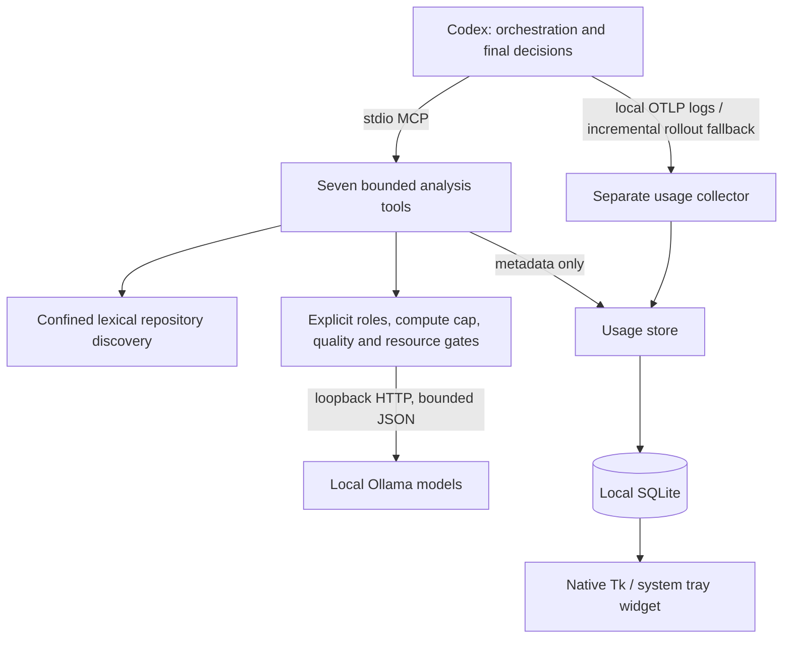

# Architecture

`server.py` declares MCP schemas; `service.py` prepares bounded content and evidence.
`context.py` performs lexical discovery without embeddings. `adaptive.py` chooses
the smallest eligible capability strength; `models.py` provides shared gates used
by the dashboard. A compute cap is a ceiling, never a command to run the largest
model. Missing models produce explicit installation advice, never substitutions.

At most two attempts by default, with a configurable maximum of three. Stronger
attempts receive the original bounded evidence, not the prior model's answer.
Complex work, risk/ambiguity triage, exhausted attempts, confidence/format failures,
capability, memory and reviewed-quality limits can return work to Codex. A handoff
is a recommendation, not an automatically executed cloud request.

`bridge.py` serializes calls within each server instance and streams Ollama output.
Different MCP instances are not globally serialized; avoid concurrent heavy runs
on constrained hardware. It never executes generated code or model tool calls.
Fixed consensus is two or three configured roles, with Codex resolving disagreement.

`telemetry.py` writes allowlisted metadata to SQLite, including logical task IDs,
intermediate attempts and final returned payload sizes. These are distinct accounting
units. `collector.py`, `otel.py` and `codex_usage.py` run independently of MCP.
`dashboard_state.py` derives readable model states; `dashboard.py` uses native tabs.
Hardware process sampling runs only during explicit benchmarks.

Older single-model configs and v0.1 tool arguments remain supported. SQLite
migrations only add tables/columns; a new checkout creates an empty local database.
