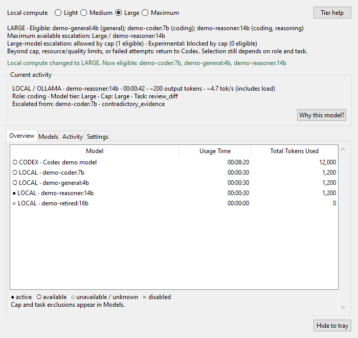
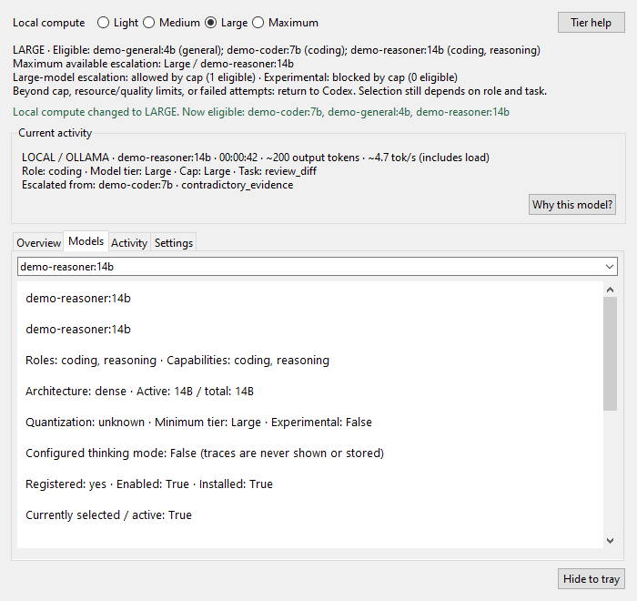
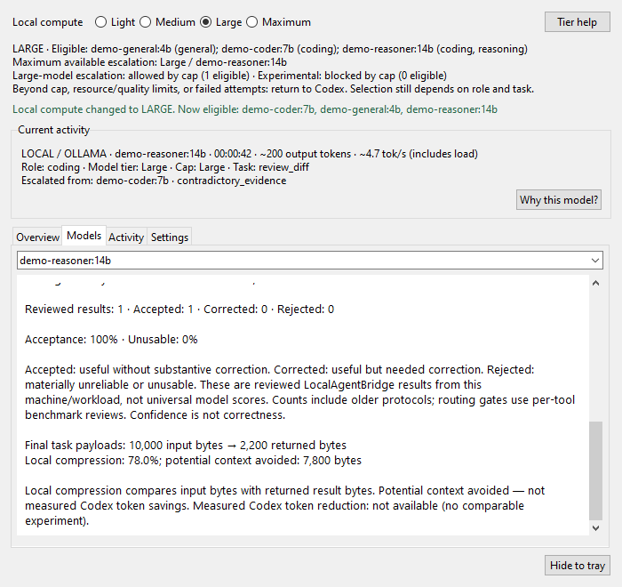
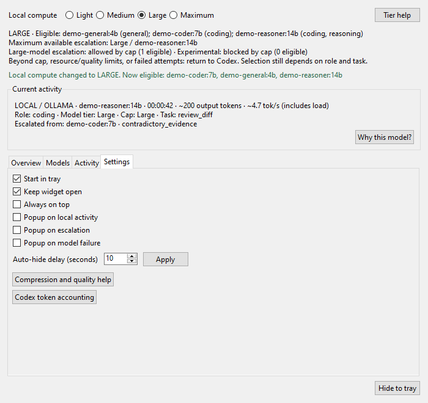

# Reading the dashboard

The native widget starts in the system tray by default. Open it from the tray menu.
It uses Tk and pystray, without a browser engine. These screenshots contain
**synthetic demonstration data**; the names, grades and usage totals are not benchmarks.



## Compute cap

Light / Medium / Large / Maximum limit permitted escalation. Immediately below
the selector are the exact currently eligible model tags and roles, the highest
available escalation tier/model, heavy/experimental permission and the Codex fallback.
Tier help explains the selected tier; right-click another tier to inspect it.
Descriptions come from registry entries and shared routing gates.

Changing the cap updates eligibility immediately and persists across processes.
A model can pass the cap but fail memory, measured latency, availability or task
quality checks. General eligibility means at least one supported tool passes; the
Models tab lists specific permitted/blocked tools. Insufficient reviews are not a
claim of validated accuracy. Role overrides and complexity can further narrow a
request. With optional quality preferences, Maximum favors the configured quality
model for more summaries; tiny discovery/compression still stays lightweight.
The tier text shows this rule and its input threshold. Without preferences,
Maximum retains smallest-first selection. See [profiles](PROFILES.md).
Unavailable/disabled models stay excluded at Maximum.
The display separates permission from availability: a tier can allow experimental
escalation while showing zero eligible experimental models.

## Current activity and routing facts

Local requests show model, role, model tier, request cap, tool and elapsed wall time.
Escalation includes the previous model and recorded reason. Why this model? shows
actual recorded facts: role/complexity, cap, selection rule, and whether quality
gates passed or lacked enough reviews. It never displays chain-of-thought or invents
an accuracy ranking. Older/fixed records say selection details are unavailable.

Live local output tokens are estimated from generated text and any hidden thinking
length; thinking contents are never stored or displayed. Live speed includes
load/prompt time. Final Ollama counters replace estimates in history; generation
speed uses final generation duration only. Activity shows the latest 15 routing
events, including escalation arrows, failures and reported outcomes. This history
contains metadata only.

## Overview and model states

The three columns are Model, Usage Time and Total Tokens Used. Rows are explicitly
labelled LOCAL or CODEX. Total token usage must not be read as generated tokens.
Indicators work without color: ● active, ○ available, ◌ unavailable/unknown,
× disabled. Choose a model for details; choose a Codex row for its counter breakdown.



Model cards distinguish installed, registered, enabled, eligible and active state.
Disabled reasons and cap/quality/resource blocks are visible. Metadata includes
installed but unregistered models, which cannot be routed until explicitly configured.
For registered models, metadata includes
roles/capabilities, dense/MoE architecture, active and total parameters, quantization,
minimum tier, weight size, calls, total tokens, latency, generation speed and reviewed
outcomes. Allocation/VRAM figures appear only when measured; otherwise fit/offload
say unknown. MoE active parameters never stand in for its full memory footprint.

## Quality and compression

Scroll the selected model card to see counts and metric explanations:


- **Accepted:** Codex accepted the result without substantive correction.
- **Corrected:** useful output that required correction.
- **Rejected:** materially unreliable or unusable output.

Acceptance = accepted / reviewed; unusable = rejected / reviewed. Unreviewed calls
do not enter these rates. Results describe local workloads on a particular machine
and test set, not universal benchmarks. Confidence and consensus are not proof.
Cards include older reviewed protocol failures; routing gates use per-tool benchmark
reviews. The reference report separates protocols, such as GPT-OSS think=false
failures and the compatible low-thinking run. Configured thinking mode is visible;
no thinking trace is displayed.

**Local compression** is 1 - returned bytes / input bytes. For example, 10,000 bytes
in and 2,200 bytes returned is 78% compression and 7,800 potential avoided bytes.
Negative compression means expansion; potential avoided bytes never go below zero.
Input is supplied context content, excluding the objective, instructions and schema.
Codex tool definitions and orchestration overhead are also outside this comparison.
Final logical envelopes are counted once, including escalation metadata. Other
individual outputs (legacy/fixed calls and consensus participants) appear separately
because they do not have the same final-envelope coverage. An incorrect short answer
or a handoff without useful analysis is not evidence of savings.

**Potential context avoided — not measured Codex token savings.** Measured Codex
token reduction remains unavailable until a comparable with/without-delegation
experiment exists. Local prompt/output token usage is separate; byte compression
must not be silently converted into exact tokens or avoided cloud calls.



Codex input includes cached input; output includes reasoning when reported. Total
means input plus output. Repeated context can be counted on successive requests.
The collector differences cumulative rollout counters and reconciles overlapping
OTel/rollout streams per session/model. Missing counts remain unavailable. Codex
usage time is observed activity windows; local time sums request duration.

## Non-intrusive settings



Start in tray, Keep open, Always on top, three popup switches and auto-hide delay
are local persisted settings. Popups default off. Automatic Windows show uses
SW_SHOWNOACTIVATE and does not request keyboard focus. Closing hides the window;
Quit in the tray stops the widget and collector.

Inventory runs on a worker thread at the configured discovery interval. The widget
never triggers inference. Aggregate refreshes pause while hidden; activity polling
continues. Window/text layout adapts to available screen size and font scaling.
Native tests cover simulated 100%, 125% and 150% Tk scaling; this does not replace
testing on every physical monitor/DPI configuration.

Regenerate screenshots using only demo data:

```powershell
.\.venv\Scripts\python.exe scripts/demo_dashboard.py --screenshots docs/images
```
