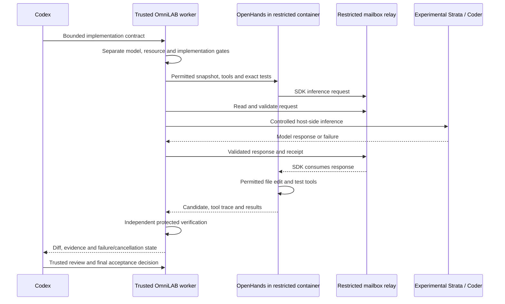

# OpenHands with Strata: implementation qualification

**BLOCKED — experimental integration, not approved for production admission.**
First complete [Strata standalone acceptance](STRATA-STANDALONE.md). Its success
would establish inference service behavior, not an accepted implementation task.
The [Ollama/Qwen advisory lane](WORKFLOW.md#task-lanes-and-inference-providers-are-separate-dimensions)
continues independently and does not require OpenHands or Strata.

## What changes and what stays responsible

For this implementation lane, Codex scopes and reviews work; OmniLAB manages
admission, durable jobs, evidence and recovery; OpenHands supplies the agentic
tool loop. Strata replaces the inference backend for an explicitly qualified
contract. Generating a tool call does not make Strata an implementation framework.

Source map: [`prepare`, `implementation`, `verify`, `execute`](../localagentbridge/selective.py),
[SDK runner, relay and tool registration](../localagentbridge/executor_assets/runner.py),
[`ChatProvider`](../localagentbridge/inference.py),
[`DockerSandbox`](../localagentbridge/sandbox.py),
[review guard](../localagentbridge/task_store.py) and
[integration verification](../localagentbridge/integration.py).
The diagram describes implemented transport; the Strata end-to-end acceptance
below has **not** passed.

The SDK talks to its container-local relay. A restricted mailbox crosses the
sandbox boundary through the trusted worker. The container has no external
network, runs non-root with dropped capabilities, and retains CPU, memory,
process and storage bounds. Do not add `host.docker.internal`, host networking,
another inference port mapping or direct container access to Strata.

## Required evidence before enabling this combination

| Step | Acceptance evidence | Status |
|---|---|---|
| Standalone prerequisite | Accepted browser/API/inference/resource/cancellation/unload/shutdown record bound to exact identities | BLOCKED; see standalone guide |
| Provider/model selection | Exact Strata URL, engine/model/serving identities, context and usage accounting; no fallback | VERIFIED adapter tests; live qualification NOT TESTED for this sequence |
| Tool protocol | Valid SDK tool request/response round trip, bounded argument validation, observed tool execution | Offline tests only; live target NOT TESTED |
| Repository inspection | Only contract-declared snapshot/context paths visible; no host workspace escape | Existing sandbox tests; live target NOT TESTED |
| Bounded modification | Real `file_editor` change to a permitted fixture file; retained before/after hashes and diff | NOT TESTED with this target |
| Testing | Baseline protected test fails for the intended defect; exact approved test passes on candidate; exit/output retained | NOT TESTED with this target |
| Failure/cancellation | Denied path/tool, provider error, timeout, cancellation and recovery retain honest state and reservations | Offline coverage exists; live target BLOCKED |
| Resources | Strata plus Docker/executor fit under unchanged admission and runtime guards | BLOCKED; standalone fit and combined budget unqualified |
| Final review | Codex independently checks diff/tests and records accepted, repaired or rejected outcome | NOT TESTED; no accepted candidate exists |

Existing automated evidence:
[provider tests](../tests/test_selective_providers.py),
[contract/lane-independence tests](../tests/test_selective_contracts.py),
[sandbox tests](../tests/test_selective_sandbox.py),
[flow tests](../tests/test_selective_flows.py),
[integration tests](../tests/test_selective_integration.py) and
[Strata accounting tests](../tests/test_strata_accounting.py).
These tests do not represent a live Strata coding pass.

Use a disposable repository and isolated store/configuration. Freeze an obvious
small defect, its permitted edit, protected acceptance test and exact test argv.
Preserve tool invocations and results, provider receipts, candidate hashes,
bounded logs, resource peaks, cancellation acknowledgement and final review.
Reject a candidate that edits protected tests. If Codex repairs a candidate,
record that outcome rather than counting it as unassisted local acceptance.

Do not change the existing Ollama configurations to test Strata. Bind qualification
to backend, model/engine/serving identities, SDK/image, task category, context and
resource profile. A standalone pass, synthetic API response or another model's
qualification cannot satisfy this record. Stable release admission remains closed
until all required evidence and release gates pass.
