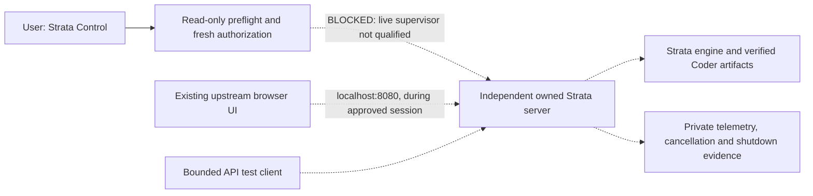

# Strata standalone qualification

**BLOCKED — independent operation is an acceptance requirement, not an achieved
result.** The installed Strata Control opens independently, but its live Start
action is not implemented/qualified. Its synthetic process checks do not load a
model. The 2026-10-17 inspection found no listener on `127.0.0.1:8080`.

This guide covers Strata without an OmniLAB job, OpenHands or a Codex session.
The separate [OpenHands integration guide](OPENHANDS-STRATA.md) becomes applicable
only after this standalone acceptance passes. Publication of this guide does not
enable either path.

## Installed identity and target

The inspected installation is **Strata 0.1.43 with the preserved LAB serving
patch**, based on upstream revision `7695859aa13afb248bdb4d36f9b2e95707db079d`.
The native executable SHA-256 is
`5f359e2d08e73b11fd7b0edc72652125c12f836394dbf1732cec0d461324cd6b`;
the patched `serve/server.py` SHA-256 is
`670a36ec733fadfd0880035180e1345483ea21576a90b3501b807d68209d39f0`.
The patch source and its scope are in
[`strata_serving_patch.py`](../scripts/strata_serving_patch.py) and
[its tests](../tests/test_strata_serving_patch.py). Do not silently substitute
another release or discard this patch while reusing its old qualification.

The target is **Qwen3.8-Flash-Next GSQ-RCO Coder IQ1_M**, selected as
`qwen3.8-flash-next-coder-iq1_m`. Strata's official
[model guide](https://github.com/Niko1221/Strata/blob/main/docs/MODELS.md)
recommends Coder for 32 GB systems. The artifact is published by **ISTA-DASLab**,
not by the Qwen organization: preserve that distinction when using the word
"official." The two existing files correspond to the publisher's
[pinned IQ1_M directory](https://huggingface.co/ISTA-DASLab/Qwen3.8-Flash-Next-GSQ-RCO-Coder-GGUF/tree/5348543e0147355ac9cbcb031184a3546350988e/IQ1_M).

| GGUF shard suffix | Bytes | Publisher SHA-256 |
|---|---:|---|
| `00001-of-00002` | 29,608,446,496 | `e11083ba855e7666b48ea3f2db6a9c3a20c18751a012cc24f948de91b7087fad` |
| `00002-of-00002` | 28,800,138,432 | `316b46f3a2dbd68c900f43136ab9449f9dcc3725dfd8c794847c204bc161e113` |

The download occupies 58,408,584,928 bytes before the tokenizer, packed data,
draft model, runtime and evidence. The publisher identifies the license as
Apache-2.0. Both shards already exist; no duplicate download is needed.
**VERIFIED:** fresh full-file SHA-256 reads on 2026-10-17 matched both publisher
hashes and historical evidence. The executable, patched server, tokenizer,
direct-GGUF pack, expert profile, draft-model pack and frozen configuration also
matched their saved identities. Recheck all selected artifacts before loading.
A matching filename or GGUF header is insufficient.

This is a pruned Coder variant. Strata's guide describes expert mappings plus an
SSD-resident second shard; disk size is not resident RAM size. Its 32 GB guidance
does not prove fit on the inspected Windows host with a 12 GB RTX 3060 eGPU.
Current free RAM, GPU staging, context, caches, Windows and other applications
still determine admission. Performance published for other computers is not a
measurement of this installation.

## Existing interfaces and boundaries

The installed source includes the upstream browser UI and API. The relevant
upstream baseline is [`serve/server.py`](https://github.com/Niko1221/Strata/blob/7695859aa13afb248bdb4d36f9b2e95707db079d/serve/server.py)
and [`serve/web/index.html`](https://github.com/Niko1221/Strata/blob/7695859aa13afb248bdb4d36f9b2e95707db079d/serve/web/index.html).
Local inspection confirmed root-page serving, `/health`, `/v1/models`,
`/v1/chat/completions`, load/unload controls and client-disconnect cancellation
code. **Source presence is VERIFIED; current browser/API behavior is NOT TESTED.**
Reuse these interfaces; a second browser frontend is unnecessary.

Dashed arrows describe the standalone test still required. Runtime interface
sources are linked above; this diagram does not assert that the private control
already implements the live launcher. The existing public
[session gate](../scripts/strata_session_gate.py) and
[resource guard](../localagentbridge/selective_resources.py) explain the retained
integration safeguards; importing or running OmniLAB must not become a standalone
runtime prerequisite.

The frozen serving configuration binds only loopback, allows one request at a
time, caps context at 16,384 and output at 1,536, reserves 2,048 MiB VRAM and
disables server-side MCP tools. It has `lazy_load=false`: starting this server
loads weights. Opening an empty browser port is not a safe substitute for startup
approval, and opening a running UI must not silently trigger an unapproved reload.

## Current blockers and required remediation

Read-only preflight on 2026-10-17 sampled approximately **19.2 GiB available RAM**,
below the unchanged **22.5 GiB** startup screen. Docker/VM processes were present;
both inspected LAB stores had no pending jobs, reservations or experimental
owner. The port was unoccupied. These are dated observations, not future admission.

The previous startup approval is consumed. Native/mapped memory growth and live
cancellation remain unresolved. Strata Control currently dispatches readiness
for Strata Start, not a live server. Its shared synthetic supervisor qualification
does not establish Strata process-tree containment or memory fit. No new live
startup or large download was performed for this inspection.

Before requesting a live run, finish and independently test a Strata-specific
owned supervisor: bounded process tree, host watchdog, owner-death cleanup,
stop acknowledgement, finite deadlines and evidence limits. Keep the existing
admission/ownership checks; do not borrow Janas's 14 GiB process cap or relabel its
tests as Strata qualification. Any shared-host admission coordination must not
require an active OmniLAB worker or alter its inference configuration.

Then obtain a new, explicitly scoped authorization for an exclusive test window.
Closing Docker/Open WebUI affects a separately running application and requires
that operational choice; do not terminate unrelated workloads automatically.
Repeat RAM/commit/pagefile, GPU, disk, backup, port and ownership checks immediately
before launch. Failed gates stop the attempt without lowering thresholds.

## Standalone acceptance sequence

| Check | Evidence required | Current result |
|---|---|---|
| Executable, configuration, launcher and model inventory | Exact hashes, upstream revision, resolved arguments, no missing auxiliary artifacts | VERIFIED inventory; live launcher gap identified |
| Start from Strata Control | Fresh approval; admitted owned server; startup duration and loaded identity | BLOCKED by launcher qualification, approval and resource gates |
| Browser | Actual upstream page at port 8080; interaction during the authorized session | NOT TESTED; no listener |
| OpenAI-compatible API | Real model-list and completion requests; exact model and honest usage | NOT TESTED in this standalone acceptance |
| Coding and tool-call response | Correct bounded coding answer; valid tool name/arguments; no implicit tool execution | NOT TESTED |
| Resource behavior | Startup/TTFT/generation throughput; RAM/commit/mapped memory, VRAM/GPU, paging and disk I/O over time | NOT TESTED for this sequence; historical measurements are not acceptance |
| Cancellation | Interrupt a bounded in-flight request; prove engine stops and no hidden work continues | BLOCKED pending supervised live qualification |
| Unload and shutdown | Confirm engine/process identities gone and RAM/VRAM released; distinguish unloading from stopping the HTTP server | NOT TESTED |
| Restart | Separately authorized reload/restart cycle, rechecked guards, no reuse of a one-start approval | NOT TESTED |
| Independence | Repeat accepted operations without an OmniLAB worker, OpenHands or Codex session | NOT TESTED end to end |

Use fixed small requests and retained expected answers. For the tool-call probe,
offer a harmless schema such as `lookup_fixture(symbol)` and validate its JSON;
do not execute returned tool calls on the host. Record raw bounded responses and
actual token counters. Report generation-only tokens/second separately from
whole-request throughput and time to first token. Stop on driver, paging,
ownership, resource or cancellation uncertainty. Do not mask a failed test with
an automatic retry or provider fallback.

Each run must end in VERIFIED, FAILED, BLOCKED or NOT TESTED with an exact scope,
timestamp and next action. Screenshots, process IDs, machine paths, full configs
and unsanitized logs stay in private evidence. Publish only the reviewed summary.
