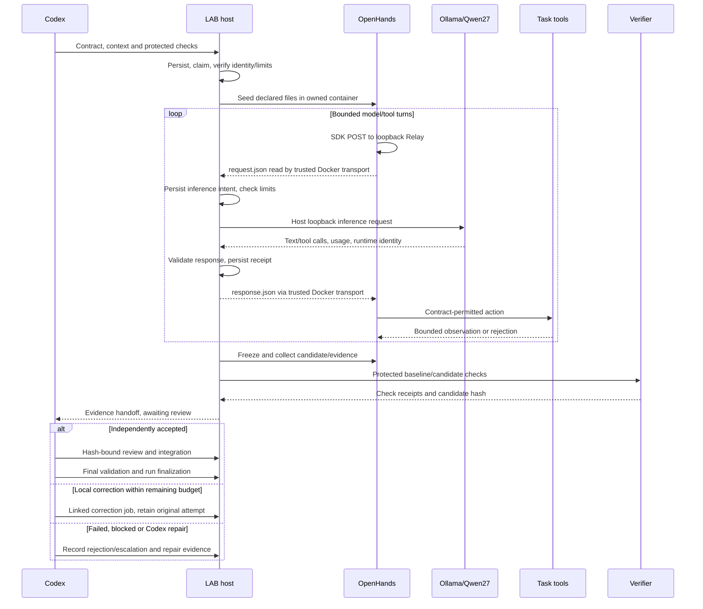
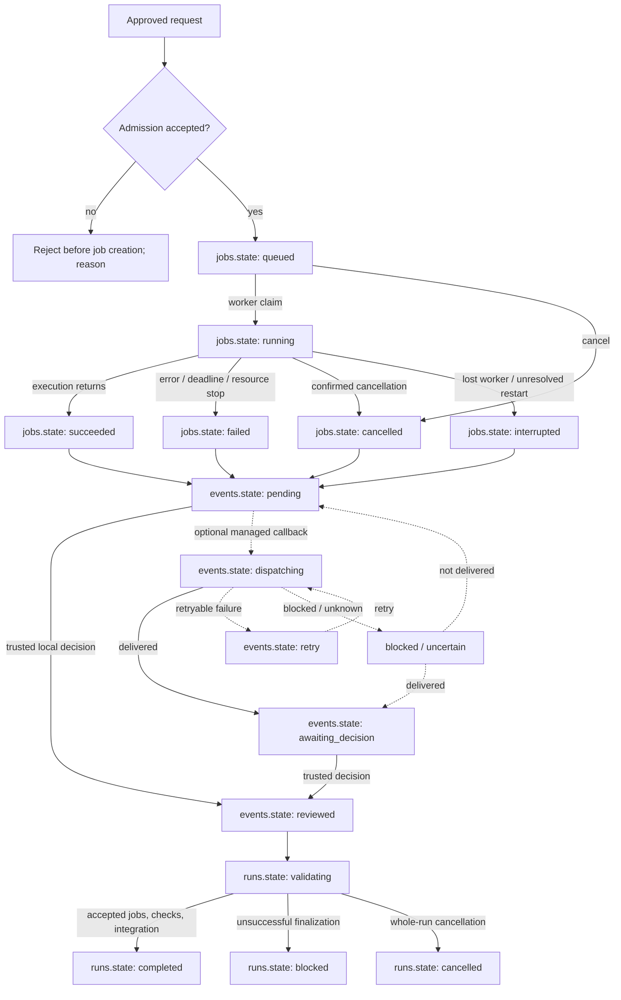
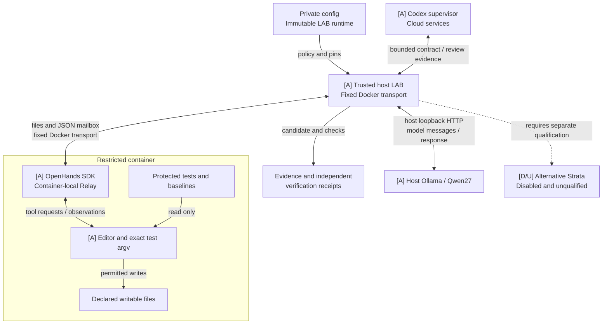
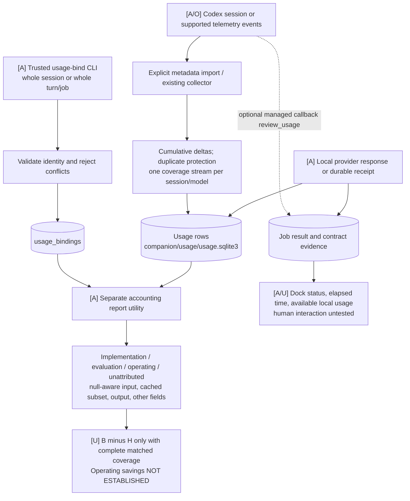

# End-to-end supervised local workflow

This guide describes the implementation checkpoint, including retained v0.4.1 and
v0.5 interfaces. The [README overview](../README.md#how-it-works) is the canonical
system diagram. The diagrams below each explain a different view; arrows describe
requests, observations or record updates, not grants of authority.

**Legend throughout:** `[A]` active and exercised in the qualified project;
`[D]` implemented/configured but disabled; `[O]` optional or conditional;
`[U]` untested or blocked. Dashed edges denote conditional paths. A component can
be implemented and automatically tested while its human interaction remains untested.

## Requests, policy and context

Codex receives the user request, decomposes it, decides which bounded work is
suitable locally, and independently accepts the result. LAB supplies durable
orchestration, policy, budgets, evidence and review state. The local model proposes
text or actions; it cannot grant permissions or make acceptance decisions.

| Entry point | Input and output | Purpose and scope |
|---|---|---|
| Stdio MCP, `server.create_server` | Bounded analysis inputs or enabled selective contracts; structured results/status | Existing analysis tools and optional agentic workflows remain. Selective MCP exposes submission/status, not acceptance or integration authority. |
| Companion CLI, `companion_cli.run` | Task JSON, exact model/role choices, run/job IDs; durable records and status | Starts and controls the independent controller, submits work, records trusted review and finalizes runs. |
| Selective CLI, `selective_cli.run` | Contract arrays and explicit review/usage/evidence operations | Routes and submits bounded tasks; trusted operations review, correct, integrate and reconcile resources. |
| Companion dock | Store snapshots and user control actions | Shows jobs and review state; supports model selection, pause/cancel and details. It is not the worker. |
| Retained direct/adaptive workflows | Selected excerpts, skill/profile definitions, compute controls and checkpoints | Preserve pre-selective v0.5 behavior; see [durable workflows](COMPANION-WORKFLOWS.md). |

The controller must be independent of the short-lived MCP process. A request
persisted through MCP survives closure of the submitting client. The qualified
runtime uses a frozen, non-editable package and its own data directory; changing
this source checkout does not upgrade a running controller.

A selective `Contract` records the objective, requirement reference, acceptance
criteria, non-goals, repository/base revision, permitted/context/protected files,
allowed read/edit/test operations, exact test argv, selected skills/role,
dependencies, risk, requested lane, provider/model/identity and limits.
The supervisor chooses the scope. Context is supplied explicitly or selected
from the declared snapshot; LAB does not give the model unrestricted repository
or personal-directory access.

Skills and project profiles are versioned data with hashes and instructions.
Catalog checks enforce required reviews, model/context constraints and operation
restrictions. Task content, repository text and local output remain untrusted.
The protected acceptance inputs are distinct from editable task files.

For exact companion jobs, explicit `--model` takes precedence over the persistent
selector, which takes precedence over the configured project default. Configured
roles can otherwise select routed execution; an explicit model selects exact
execution. Retained workflow allowlists/budgets are not rewritten by the selector.
For selective contracts, the backend/model pair resolves its own qualified
profile. A different backend needs its own model and identity; overrides cannot
borrow Qwen27's acceptance. See [configuration](CONFIGURATION.md),
[profiles](PROFILES.md) and [role mapping](ROLE-MIGRATION.md).

| Effective lane | Execution | Why/when |
|---|---|---|
| `codex_direct` | Records a handoff to the supervisor; no local inference | Unapproved, ambiguous or unsuitable work returns with a reason. LAB does not automatically invoke a cloud model. |
| `local_advisory` | LAB → provider → model → text/evidence | Focused analysis and documentation; no model-directed task tools. Qualified native Ollama uses `ChatProvider`; retained legacy advisory uses `Bridge`. |
| `local_implementation` | LAB → OpenHands SDK/tools, with inference relayed to the provider | Requires approved low-risk, coherent, reversible scope, protected checks, permitted files, resource fit and exact capability evidence. |

Admission verifies identity, profile/settings, skill constraints, qualification,
sandbox and host resources. A missing/mismatched model or insufficient headroom
returns a failure/reason, not a smaller model, CPU fallback or silent cloud call.
Output, attempts and repairs remain bounded; larger tasks are split.

## Bounded implementation sequence



The sequence shows the successful route after admission. Exceptions, malformed
calls, truncated output, resource pressure and timeouts retain failure/partial
evidence. An intent without a matching receipt is uncertain and must not be
blindly replayed. Per-request receipts count failed/retried requests too.
A local correction creates a linked job with retained scope and bounded attempts.
Codex repairs need independent checks and an explicit outcome; they do not become
“accepted without repair.”

Advisory work takes the direct LAB/provider branch and returns text for review.
The `codex_direct` lane hands work back without OpenHands or inference. Strata
would replace the inference provider only after separate qualification; it is
never a stage between OpenHands and Ollama.

## Job lifecycle



This diagram uses **stored values**, with table prefixes to distinguish records.
The finalization arrows summarize guards; unresolved events/jobs prevent
finalization instead of automatically advancing. Callback reconciliation may
return to `pending` or `awaiting_decision` depending on recorded delivery.
A job's `succeeded` means execution returned, not that its patch passed checks
or Codex accepted it. Review is a separate record, not an invented job state.

| Record/axis | Implemented values or meaning |
|---|---|
| `jobs.state` | `queued`, `running`, `succeeded`, `failed`, `cancelled`, `interrupted` |
| `runs.state` | `ready`, `local_queued`, `local_generation`, `waiting_for_codex`, `reviewing`, `validating`, `cancelling`, `completed`, `blocked`, `cancelled` |
| Selective execution | `queued`, `running`, `finished`, `returned_to_codex`, `failed`, `interrupted`, `cancellation_pending` |
| Verification | `not_run`, `running`, `passed`, `verification_failed` |
| Review | `awaiting_review`, `accepted`, `rejected`, `escalated` |
| Integration | `candidate`, `integrating`, `integrated` |
| Dispatch | `not_dispatched`, `preparing`, `dispatched` |
| Inference reservation | Singleton owned by job/attempt; `active` or `cancellation_pending` until confirmed release |

Pause prevents new claims; it does not cancel active work. The worker serializes
jobs and checks dependencies, reservations and admission again. The SQLite
reservation coordinates this configured store, not every possible LAB deployment
on a machine. Competing resident models are checked separately.

Restart recovery reconciles durable results and owned processes. Legacy workflow
receipts can complete delivery without another inference; an unfinished native
advisory becomes interrupted with uncertainty retained. An implementation recovery
inspects the owned executor and collects recoverable evidence rather than blindly
starting another agent. Only demonstrably owned processes can be stopped.

There is no persisted `expired` companion job state. Selective attempt/inference
deadlines fail bounded execution. Retained workflow leases expire to `handed_off`
with an interrupted reason, retain charged budgets and reject late ownership.
Ollama's 120-second keep-alive controls model residency, not job acceptance or
reservation expiry. Uncertain inference cancellation requires trusted
reconciliation; see [recovery](RECOVERY.md) and [operations](SELECTIVE-SETUP.md).


## Trust boundaries and data movement



The SDK posts to `http://127.0.0.1:8765/v1/chat/completions` **inside the
container**. Its `Relay` writes `/exchange/request.json` and waits for the matching
`response.json`. The trusted host worker reads/responds using fixed Docker
transport operations, then makes the host-loopback Ollama request. There is no
container network route to host Ollama and no shared host-directory mount.

This is the corrected, source-checked integration of Qwen27's documentation
draft: the mailbox is not a network proxy exposed to task tools. OpenHands manages
the tool loop, the model proposes actions, and LAB enforces the surrounding
contract and collection limits. The diagram includes the tool observations omitted
by the local draft. Codex independently reviews candidate bytes and acceptance;
publishing credentials and acceptance authority never enter the worker context.

The accepted container is nonroot (UID 10001), read-only except bounded tmpfs,
networkless, capability-dropped, and has no Docker socket, host shell, personal
directories, SSH keys, browser profiles or Codex authentication. Protected tests
and original baselines are not writable. Independent verification uses separate
baseline/candidate sandboxes before trusted integration. Task tools have no
outbound network; **the complete Codex-supervised workflow is not offline**.

## Where information lives

Paths below are source-defined layouts relative to configuration, not public
copies of private machine paths. `config.load_config` selects explicit `--config`,
then `LAB_CONFIG`, then current-directory `config.toml`. Relative paths resolve
against that TOML. The default data directory is under `LOCALAPPDATA/LocalAgentBridge`;
the qualified deployment uses a private dedicated directory instead.

| Information | Storage and reader |
|---|---|
| Personal/project policy, endpoints, pinned identity/settings | Private ignored `config.toml`; operator-selected path read by LAB. Public TOML examples are sanitized and are not activation records. |
| Runs, jobs, requests, results, events, deliveries, recovery and selector settings | `data_dir/companion/companion.sqlite3` via `CompanionStore`. Requests include the authorized context/policy; this is **not metadata-only** storage. Controller/worker reads queue, dependencies, process identities, locks/heartbeat and review outbox. |
| Contract axes, audit, measurements and inference reservation | Additive tables in that same companion DB through `TaskStore`; records include evidence objects and external artifact references. |
| Snapshot, prompts, responses, diffs and checks | `data_dir/companion/artifacts/JOB_ID/`. Lane-dependent artifacts include `base.json`, `advisory.json`, `candidate.json`/`candidate.patch`, `evidence.json`, `intent-*.json` and `inference-*.json`; failed collection and resource samples are retained. DB results/evidence may also contain response data. |
| Model-directed task workspace and SDK state | Container-local bounded `/workspace`, `/state` and `/exchange` tmpfs; declared bytes are copied in and collected out by trusted orchestration. No host-drive mount. |
| Selective local/cloud accounting rows and attribution bindings | `data_dir/companion/usage/usage.sqlite3` via the existing telemetry `Store` and accounting utility. Local receipt IDs deduplicate requests; private run/turn/session identifiers are retained here. |
| Legacy usage and workflow ledgers | `data_dir/usage.sqlite3` and existing workflow storage; bounded workflows keep budget/ownership metadata, while the companion journal persists private replay receipts and packets. |
| Optional managed Codex callback artifacts | `data_dir/companion/reviews/RUN_ID/DELIVERY_ID/`: prompt, invocation, events, stderr and response files. The qualified controller does not enable cloud callbacks by default. |
| Codex session source events | Existing Codex session files selected explicitly for metadata import; LAB does not relocate or publish them. |
| Model weights/templates | Backend-owned installation, outside the job DB and task sandbox. LAB records hashes/bindings; it does not install, copy or delete weights at dispatch. |

Acceptance inputs and original checkouts are retained independently. Source/Git
snapshots exclude uncommitted changes unless the trusted supervisor explicitly
freezes and reviews those bytes. Evidence bundles, runtime DBs, logs, private
configuration and model assets are excluded from the public source allowlist.

## Accounting and observability



The close-out added whole-unit attribution to the existing accounting store; it
did **not** replace the active controller or automatically instrument every cloud
phase. `contract-usage-bind` associates a cloud session/turn or local run/job with
an accounting run/task and category. Conflicting/overlapping bindings fail;
repeating an identical binding is idempotent. No fractional turn allocation exists.

Reports separate implementation/setup investment, evaluation overhead, normal
operating tasks and unattributed usage. Shared controller/reporting work must
remain visible as a whole labeled unit or unattributed coverage. Retrying,
repairing, failing and falling back do not erase the preceding costs.
Source/session/turn/request IDs and the report cutoff identify coverage.

Cloud input includes cached input; output includes reasoning where reported.
Cached-input, cache-write and reasoning counters stay separate, never added again
to input/output totals. Missing counters are unknown, not zero. Duplicate
cumulative events add no tokens. Overlapping rollout/telemetry streams are selected,
not summed. Local input/output are actual provider measurements; serialized-byte
context bounds are admission estimates, context capacity is a limit, and maximum
output is an allowance.

The dock reads companion job/results and evidence, including available local
usage and optional callback `review_usage`. It does **not** query attribution
category totals or show live measured savings. Presentation labels distinguish
observed, estimated and unavailable metrics; a derived display label such as
“verifying” is not an extra persisted job state.

Operating savings require equivalent independently accepted work: complete
Codex-only cloud usage B, and complete hybrid cloud usage H including planning,
dispatch, review, every local retry, cloud repair and fallback. Net avoided cloud
tokens are B − H; percentage is 100 × (B − H) / B for B > 0. Negative values stay
negative. Report identical starting snapshots, requirements, acceptance, Codex
model/settings and cache conditions, with no solution leakage between runs.

The retained generation-only baseline and shared hybrid supervisor turns do not
isolate complete matched B/H. Whole-unit bindings fix association, not missing
historical coverage. **Savings remain not established; no new comparison was run
for documentation publication.** A future isolated comparison supports its sample
only. Local tokens are not cloud tokens saved, and token reductions do not imply
a lower subscription bill. [Accounting methodology](SELECTIVE-PILOT.md) preserves
historical totals as dated windows, not current lifetime usage.


## Worked example from accepted evidence

During the 2026-10-10 close-out, the supervisor requested a short operator paragraph
about complete usage attribution, retries, unknown counters and valid savings
claims. Context was a bounded source-backed excerpt from `usage_report.py` plus
the frozen accounting facts; the task did not expose the repository or publishing
credentials. This was `local_advisory` through the existing controller and qualified
Ollama/Qwen27 profile, not an OpenHands implementation task.

LAB persisted the task, exact identity/profile, admission, provider receipt and
candidate hash. The model returned a 106-word paragraph in one inference attempt:
**291 input / 130 output tokens; cached input unavailable**. Codex independently
compared each assertion against the implementation and acceptance criteria,
accepted it without repair, integrated it unchanged in
[close-out attribution](SELECTIVE-PILOT.md#close-out-attribution), recorded review
coverage and finalized the run.

The sanitized opening is: “Operators attribute usage by binding complete sessions,
turns, or jobs to specific tasks and categories.” The rest remains at the linked
canonical location. This is actual accepted documentation work, not a hypothetical
tool run or evidence of net savings. The [contribution ledger](LOCAL-CONTRIBUTIONS.md)
also records the separate, corrected transport draft used for this guide.
Private job/run receipts remain private; public text records compact outcome and
usage, not raw prompts, runtime databases or machine paths.

## Qualified personal profile

This is the **2026-10-10 qualification example** for this project checkout.
It is not a mandatory public default, a newly run comparison, or authorization
for other repositories. The active configuration and explicit overrides are
preserved. [Qualification evidence](OPENHANDS-STRONGER-QUALIFICATION.md#standard-model-milestone)
and [operations](SELECTIVE-SETUP.md#qwen27-project-workflow) retain the detailed history.

| Item | Verified value |
|---|---|
| Installed tag / model | `qwen3.8:27b`, called Qwen27; dense qwen35, 27,320,697,856 parameters |
| Full manifest digest | `aaee06c39dcf2437cde036998d960e1fc1494b8191be7cc9657d01e509097813` |
| Main weight SHA-256 | `f5f1dd8920d417aac2718b0bda3403da274301efdd6760b4f0f4b864ff2ad57d` |
| Ollama | 0.40.2, host loopback `http://127.0.0.1:11434` |
| OpenHands SDK/tools | 1.53.0, SDK integration only; no installed web UI |
| Executor image | `sha256:b0ec53df107bdbb7b9df9c397ee56d4f7f74bc49d6e6550b16ca6f23e5748090` |
| Model/profile | Q4_K_M; 28 GPU layers; MTP draft 4; context capacity 65,536; maximum output 1,536 per response |
| Native request settings | `num_ctx=65536`, `num_predict=1536`, `num_gpu=28`, `draft_num_predict=4`, `temperature=0`; `think=false`, `truncate=false`, `shift=false`, `keep_alive=120` |
| Actual runner flags | `-c 65536 -ngl 28 --spec-draft-n-max 4 --spec-type draft-mtp --host 127.0.0.1 -np 1 --chat-template chatml`; no-jinja |
| Stored Ollama template SHA-256 | `b507b9c2f6ca642bffcd06665ea7c91f235fd32daeefdf875a0f938db05fb315` |
| Remaining stored backend settings | top_k 20, top_p 0.95, min_p 0, repeat_penalty 1, presence_penalty 0; distinguish these stored values from the explicit request options above |
| Publication advisory runtime observation | Matching loaded identity/context, runner flags and positive loaded VRAM: 8,051,543,243 bytes |

Runtime binding checks the installed version, digest, quantization and template,
then actual loaded context, runner identity/flags and positive GPU allocation.
Unsupported settings or mismatch fail safely before returning tool calls.
The context limit is capacity, not evidence that each prompt consumed 65,536 tokens.

Admission requires 6 GiB host RAM available. The guard stops below 2 GiB immediately,
below 3 GiB for 15 seconds, above 11,776 MiB GPU allocation or on unavailable GPU
diagnostics. One inference workload is admitted; switching providers cannot leave
unadmitted competing models resident. The sandbox retains 2 GiB/no-swap, two CPUs,
128 PIDs, bounded tmpfs and collection. Each task allows eight inference requests,
two error-recovery cycles, two supervisor-authorized attempts, zero transport
retries, 15-second test commands, 16 KiB outputs and a 30-minute attempt ceiling.
These are ceilings, not claims of actual usage.

Current Strata protocol/selection changes and current upstream inspection are recorded in
[the upgrade report](SELECTIVE-IMPLEMENTATION-REPORT.md#windows-mapped-page-release-trial--2026-10-13).
The final patched 0.1.43 runtime with engine-only mapped-page release passed fresh
A/B. Idle memory remained below admission; a competing runtime later triggered
the whole-GPU guard. OpenHands/Strata and live safety checks remain unqualified.
The following 2026-10-10 inventory remains historical.

That historical inventory had an implemented adapter but **no qualified runnable installation or
compatible loaded weights** in the bounded inventory. The inspected upstream
commit `fb58e0dbc8399662c0e47c76578c6e878b14f6cf` targets Flash-Next variants;
it does not qualify dense Qwen27. The standard engine 0.1.41 CUDA 13 driver
requirement is unmet by recorded driver 560.94, and the CUDA 12 alternative remains
unqualified. No proposed model payload was downloaded. The disabled
`http://127.0.0.1:8080` example is not an available service.
See [Strata blockers and licenses](SELECTIVE-SETUP.md#independent-strata-status);
none blocks the accepted Ollama/OpenHands path.

## Operation, rollback and validation

The canonical [operator guide](SELECTIVE-SETUP.md#qwen27-project-workflow) contains
start, stop, status, inventory, dock and cancellation commands, private installation
record locations, ownership safeguards and rollback. Use the frozen runtime's
Python and the absolute private project-config path. CLI `--help` is safe to
inspect; do not restart or replace the active controller just to read this guide.

For a generic bounded advisory, after creating a run, the supported shape is:

```text
python -m localagentbridge --config LOCAL.toml companion create
python -m localagentbridge --config LOCAL.toml companion submit --run RUN_ID --request task.json --model EXACT_TAG
python -m localagentbridge --config LOCAL.toml companion status --run RUN_ID
```

`RUN_ID` and `EXACT_TAG` are placeholders; use the actual creation result and
installed identity. See [task example](../examples/companion-task.json).
Implementation uses [contract commands](SELECTIVE-SETUP.md#contract-and-review-commands)
and [contract example](../examples/selective-contract.json), with separate trusted
review, protected verification and explicit integration. A locally successful
candidate is not permission to publish.

Rollback pauses admission, resolves/cancels owned work, shuts down the owned
controller and restores the saved prior configuration/selector, retaining models,
DBs, accepted patches and history. The private rollback helper refuses unresolved
work and archives the current configuration. The earlier disposable rollback
check is evidence; publication does not execute rollback or restart services.

The close-out's clean source validation recorded **591 passed / 1 skipped**.
Its **180 extracted-wheel checks overlap** that suite and are not added to it.
Those are historical close-out results. The historical 2026-10-12 Strata adapter pass
changed runtime source and recorded: **614 passed / 1 skipped**.
See the [current implementation report](SELECTIVE-IMPLEMENTATION-REPORT.md#windows-mapped-page-release-trial--2026-10-13)
for package, diagram and publication checks.

The [manual ledger](release-testing/selective-execution-issue-draft.md) has exactly
**11 human rows**, none fully accepted (the owner confirmed launch and some selections only): package/launch/rollback; model/backend/usage;
override persistence; idle → running → awaiting review → completed; keyboard/focus/
DPI; hide/reopen/cancel; retained workflow controls; conditional managed callbacks;
OpenHands isolation/tool round trip; stale/forged acceptance and recovery;
conditional resources/matched pilot. Automated or earlier live runtime evidence
does not mark those human checks passed. Preserve its
`Test | Tested? | Result | Issue registered | Evidence/notes` format.

## Source map

The README's host inference adapter executes inside `selective.execute` /
`implementation`, not a separate inference service. `DockerSandbox.read/respond`
performs fixed host-side transport; the SDK's `Relay` uses container loopback
only. The trusted review arrow is CLI `TaskStore.review`, never an MCP/model
acceptance tool. `CompanionDock.refresh_models` separately reads backend metadata;
`select_default` stores the exact future choice, while `pause/cancel` update
control state. The older telemetry widget reads `telemetry.Store` through
`dashboard_state.snapshot`; it is separate from the job dock.


Each link identifies implementation, not authority for a local agent. Tests are
automated unless the linked qualification/ledger explicitly says otherwise.

| Diagram component | Responsibility | Actual module/function | Validation evidence |
|---|---|---|---|
| Entry points | MCP registration; CLI parsing and dispatch | [server.py](../localagentbridge/server.py) `create_server/companion_contract_submit/companion_contract_status`; [companion_cli.py](../localagentbridge/companion_cli.py) `add_parser/run`; [selective_cli.py](../localagentbridge/selective_cli.py) `add/run` | [MCP](../tests/test_selective_mcp.py), [CLI workflows](../tests/test_companion_workflow_cli.py) |
| Context and policy | Contract validation, skill constraints, lane selection | [task_contract.py](../localagentbridge/task_contract.py) `Contract/selected_skills/route`; [catalog.py](../localagentbridge/catalog.py) | [Contracts](../tests/test_selective_contracts.py) |
| Exact defaults/overrides | Project/backend/model profile resolution | [local_profile.py](../localagentbridge/local_profile.py) `resolve_contract`; [config.py](../localagentbridge/config.py) `load_config` | [Profile tests](../tests/test_local_profile.py) |
| Retained workflows | Roles, budgets, checkpoints and restart receipts | [workflow_store.py](../localagentbridge/workflow_store.py) `WorkflowStore`; [workflow_recovery.py](../localagentbridge/workflow_recovery.py); [companion_workflows.py](../localagentbridge/companion_workflows.py) | [Workflow preservation](../tests/test_companion_workflows.py), [feature matrix](FEATURE-PRESERVATION.md) |
| Durable scheduling | Locks, controller/worker, queue, results and outbox | [companion.py](../localagentbridge/companion.py) `serve/ensure_worker/worker`; [companion_store.py](../localagentbridge/companion_store.py) `CompanionStore` | [Companion](../tests/test_companion.py), [process recovery](../tests/test_companion_recovery.py) |
| Selective state/ownership | Review guards, axes, reservation and audit | [task_store.py](../localagentbridge/task_store.py) `TaskStore/review_guard`; [process_control.py](../localagentbridge/process_control.py) | [Process tests](../tests/test_selective_process.py), [flows](../tests/test_selective_flows.py) |
| Admission/execution | Context construction, provider checks, bounded implementation and recovery | [selective.py](../localagentbridge/selective.py) `prepare/execute/implementation`; [selective_resources.py](../localagentbridge/selective_resources.py) | [Flows](../tests/test_selective_flows.py), [bounded tests](../tests/test_selective_bounded.py) |
| Inference and identity | Ollama/Strata requests, loaded identity/settings validation | [inference.py](../localagentbridge/inference.py) `ChatProvider.inspect/chat`; [strata_identity.py](../localagentbridge/strata_identity.py) `verify_binding`; [runtime_profile.py](../localagentbridge/runtime_profile.py) | [Providers](../tests/test_selective_providers.py), [Strata fixtures](../tests/test_strata_upgrade.py), [Ollama live qualification](OPENHANDS-STRONGER-QUALIFICATION.md), [Final patched Strata A/B; insufficient C memory and later GPU stop](SELECTIVE-IMPLEMENTATION-REPORT.md#windows-mapped-page-release-trial--2026-10-13) |
| Qualification-only serving patch | One initial engine start; reject non-finite and cancelled responses; no automatic reload | Upstream `serve/server.py` `StrataEngine.__init__/restart`, `Service.ensure_loaded/run`, reproduced by [strata_serving_patch.py](../scripts/strata_serving_patch.py) and [exact patch](qualification/strata-serving.patch) | [Offline counted lifecycle/protocol tests](../tests/test_strata_serving_patch.py); [exact revisions and fresh live scope](SELECTIVE-IMPLEMENTATION-REPORT.md#windows-mapped-page-release-trial--2026-10-13) |
| Experimental mapped-page release | Native Windows hint for full file-backed expert pages after GPU upload; does not set a RAM cap | Pinned upstream `FileExpertSource::release` (`src/core/expert_source.cpp`), upload/refill calls in `src/program/generate.cpp`; `serve.server.child_env` applies isolated `env.STRATA_FILE_RELEASE=1` | [Binary/activation and measured evidence](qualification/strata-file-release-evidence.json); fresh A/B and incomplete observation; no OpenHands/general-routing qualification |
| Sandbox and transport | Owned containers, SDK mailbox, path/tool bounds | [sandbox.py](../localagentbridge/sandbox.py) `DockerSandbox`; [runner.py](../localagentbridge/executor_assets/runner.py) `Relay`; [transport.py](../localagentbridge/executor_assets/transport.py); [bounded.py](../localagentbridge/executor_assets/bounded.py) | [Sandbox](../tests/test_selective_sandbox.py), [bounded qualification](OPENHANDS-BOUNDED-QUALIFICATION.md) |
| Independent integration | Protected verification, base/dependency checks, guarded writes | [integration.py](../localagentbridge/integration.py) `integrate` | [Integration](../tests/test_selective_integration.py), [acceptance](../tests/test_companion_acceptance.py) |
| Local/cloud accounting | Receipt persistence, cumulative import, attribution and reporting | [measurements.py](../localagentbridge/measurements.py) `local_usage`; [codex_usage.py](../localagentbridge/codex_usage.py) `RolloutReader`; [usage_report.py](../localagentbridge/usage_report.py) `bind_usage/investment/operating_savings` | [Attribution tests](../tests/test_usage_report.py), [usage tests](../tests/test_v2_usage.py) |
| Dock | Store snapshots, provider/model choices, derived status, counters and user controls | [dock.py](../localagentbridge/dock.py) `presentation/job_usage/CompanionDock` | [Companion tests](../tests/test_companion.py), [incomplete human checks](release-testing/selective-execution-issue-draft.md) |

See [architecture](ARCHITECTURE.md) for retained MCP/adaptive internals,
[safety](../SECURITY.md), [troubleshooting](TROUBLESHOOTING.md),
[manual testing](MANUAL-RELEASE-TESTING.md) and [upgrade](../MIGRATION-v0.5.md).
